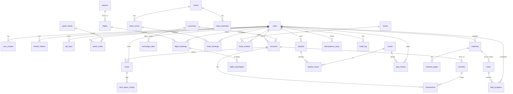

# Callbox

Tələbələrin **Postman / curl** ilə real API sorğuları göndərdiyi və nəticəni **SQL** ilə yoxladığı təlim platforması.
IT Business Analyst kursu üçün hazırlanıb (Div Academy, UNEC): Dərs 1 — API əsasları, Dərs 2 — HTTP və REST, Dərs 3 — Security, Design, API Specification.

- **API-first:** hər şey [`openapi/openapi.yaml`](openapi/openapi.yaml)-dan idarə olunur — route-lar, request validation, Swagger UI, Postman collection.
- **Real DB:** PostgreSQL 16, raw SQL, ORM yoxdur. Hər API əməliyyatını SQL Playground-da (və ya DataGrip/psql ilə) `SELECT` ilə görmək olur.
- **Hamısı lokal:** internet lazım deyil (YouTube axtarışı və məzənnə yeniləməsi opsionaldır).

---

## Tələbələr üçün 10 dəqiqəlik başlanğıc

**Lazımdır:** [Node.js 20+](https://nodejs.org) (yoxlayın: `node -v`), PostgreSQL 16, Postman və ya terminal (curl).

### 1. Serveri işə salın (3 dəq)

```bash
brew install postgresql@16 && brew services start postgresql@16   # macOS; Windows/Linux — aşağıda "PostgreSQL"
git clone <repo-url> api-lab && cd api-lab
npm install
npm run db:setup     # rollar + bazalar + migration + demo data
npm run dev
```

Terminalda `Callbox: http://localhost:3000` görünməlidir.

| Ünvan | Nə var |
|---|---|
| http://localhost:3000/docs | **Swagger UI** — bütün endpoint-lər, "Try it out" |
| http://localhost:3000/api/openapi.json | OpenAPI spec (JSON) |
| http://localhost:3000/api/postman/collection.json | Postman collection (+ [environment](http://localhost:3000/api/postman/environment.json)) |

### 2. Postman-ı qoşun (2 dəq)

Postman → **Import** → `postman/api-lab.postman_collection.json` və `postman/api-lab.postman_environment.json` faylları (və ya yuxarıdakı URL-lər).
Sağ yuxarıda environment kimi **Callbox — Local** seçin. Əvvəlcə **Auth → POST /api/v1/auth/login** göndərin — token avtomatik `{{token}}`-a yazılır.

### 3. İlk sorğular (4 dəq)

```bash
# Dərs 1 — sadə GET (API Key ilə)
curl -s "http://localhost:3000/api/v1/currencies/rates?base=AZN" -H "X-API-Key: apilab-demo-key-2026"

# Dərs 2 — CRUD: yeni müştəri (201 + Location), eyni email ikinci dəfə → 409
curl -si -X POST http://localhost:3000/api/v1/customers -H "Content-Type: application/json" \
  -d '{"firstName":"Rəna","lastName":"Quliyeva","email":"rena@example.az"}'

# Dərs 3 — login → Bearer token → kartı blokla
TOKEN=$(curl -s -X POST http://localhost:3000/api/v1/auth/login -H "Content-Type: application/json" \
  -d '{"username":"student","password":"student123"}' | node -pe 'JSON.parse(require("fs").readFileSync(0)).access_token')
curl -s -X POST http://localhost:3000/api/v1/cards/1/block -H "Authorization: Bearer $TOKEN" \
  -H "Content-Type: application/json" -H "Idempotency-Key: my-first-block-1" -d '{"reason":"LOST"}'
```

### 4. Nəticəni DB-də yoxlayın (2 dəq)

```bash
curl -s -X POST http://localhost:3000/api/v1/_db/query -H "Content-Type: application/json" \
  -d '{"sql":"SELECT * FROM card_status_history WHERE card_id = 1"}'
```

və ya terminalda: `npm run db:shell` → `SELECT * FROM v_card_overview;`

**Səhv etdiniz?** `npm run db:reset` (və ya admin token ilə `POST /api/v1/_reset`) — DB seed vəziyyətinə qayıdır.

---

## Demo məlumatlar

| Nə | Dəyər | Qeyd |
|---|---|---|
| İstifadəçi | `student` / `student123` | Aysel Məmmədova, bütün scope-lar |
| İstifadəçi | `rauf` / `rauf123` | `cards:write` scope-u **yoxdur** → kart bloku 403 (Authorization dərsi); kartları 5, 6 — BOLA nümunəsi |
| İstifadəçi | `admin` / `admin123` | ADMIN, `/_reset` və `/_history?all=true` |
| Müəllim | `.env` → `SUPERADMIN_USERNAME` / `SUPERADMIN_PASSWORD` | SUPERADMIN — `/admin` paneli; `npm run superadmin:init` yaradır (seed-də yoxdur) |
| API Key | `apilab-demo-key-2026` | Valyuta və kitab endpoint-ləri (`X-API-Key` başlığı) |
| API Key | `apilab-revoked-key-2025` | Deaktiv → 401 `INVALID_API_KEY` |
| OAuth client | `apilab-portal` / `apilab-portal-secret` | Mock "Google" Authorization Code flow |
| Hesablar | student: `AZ21NABZ0001` (AZN), `…0002` (USD), `…0003` (EUR); rauf: `…0004` (AZN), `…0005` (USD) | |
| Kartlar | 1, 2 — ACTIVE; 3 — BLOCKED (LOST, açıla bilər); 4 — EXPIRED | student-in kartları |

Scope-lar: `accounts:read`, `cards:read`, `cards:write`, `transfers:write`, `bookings:read`, `bookings:write`, `books:write`, `music:read`, `music:write`, `admin`, `superadmin`.

Seed **deterministikdir** (eyni gündə hər reset eyni datanı verir), tarixlər isə bu günə nisbətən hesablanır — reyslər həmişə "sabahdan 30 gün", otel bronları gələcəkdədir.

---

## Əmrlər

| Əmr | Nə edir |
|---|---|
| `npm run dev` | OpenAPI-ni bundle edir və serveri watch rejimində işə salır (DB boşdursa — migration + seed) |
| `npm start` | Serveri watch olmadan işə salır |
| `npm run build` | `openapi/openapi.json` və `postman/*.json` fayllarını yenidən yaradır |
| `npm test` | Backend testləri (vitest + supertest, in-memory DB; contract + security daxil) |
| `npm run test:all` | **CI — tək komanda:** lint → typecheck → backend (coverage) → portal unit (coverage) → portal build + e2e |
| `npm run test:contract` | Yalnız OpenAPI contract + təhlükəsizlik testləri |
| `npm run test:coverage` / `test:web` / `test:e2e` | Backend coverage / portal unit coverage / build + Playwright |
| `npm run lint` | ESLint + Spectral (OpenAPI lint) |
| `npm run typecheck` | TypeScript yoxlaması |
| `npm run db:setup` | PostgreSQL-i hazırlayır: rollar (`apilab`, `apilab_playground`), bazalar (`apilab`, `apilab_e2e`), ilk migration + seed. Təkrar işlətmək təhlükəsizdir |
| `npm run db:reset` | DB-ni sıfırlayır (public sxemi silinir → migrate → seed), cədvəl saylarını göstərir |
| `npm run db:migrate` / `db:seed` | Yalnız yeni migration-lar / yalnız data |
| `npm run db:shell` | `psql` (`\\dt`, `\\d cards`) |
| `npm run superadmin:init` | Müəllim (SUPERADMIN) hesabı: güclü parol yaradır, `.env`-ə yazır, DB-də yaradır. `-- --username parviz --name "Ad Soyad"` |
| `npm run materials:seed` | `materials/slides/` qovluğundakı yeni faylları import edir və konvertasiyanı gözləyir |
| `npm run openapi:lint` / `openapi:bundle` | Spec lint / YAML → JSON |
| `npm run postman:export` | Postman fayllarını `postman/` qovluğuna yazır |
| `npm run rates:refresh` | Bu günün məzənnələrini ECB-dən (Frankfurter) yeniləyir; şəbəkə yoxdursa seed qalır |
| `npm run external:verify` | `RAPIDAPI_KEY` ilə hər external API-yə 1 sorğu → status cədvəli və `verified` təklifi (`catalog.ts`-i dəyişmir) |
| `npm run classroom:check` | Sinif hazırlığı: cari konfiqurasiya; `-- --lan` — LAN rejimi üçün yoxlama + hazır `.env` bloku (təsadüfi sirlərlə, faylı dəyişmir) |

## Testlər və QA (CI)

```bash
npm run test:all      # hamısı ardıcıl; ilk uğursuz addımda dayanır (exit code ≠ 0)
caffeinate -i npm run test:all   # macOS: e2e zamanı sistem yuxuya getməsin (yoxsa testlər timeout olur)
```

İlk dəfə: `npm install`, `cd web-design && corepack pnpm install`. E2E üçün **Google Chrome** quraşdırılmalı və **port 3000 boş** olmalıdır (Playwright təzə müvəqqəti DB ilə öz serverini qaldırır — işləyən `npm start`-ı əvvəlcə dayandırın). `pdftoppm` (poppler) yoxdursa slayd önizləməsi testləri skip olunur.

| Qat | Fayl | Nəyi yoxlayır |
|---|---|---|
| Contract | `tests/contract.test.ts` | `openapi.json`-dakı **hər** əməliyyat avtomatik: spec nümunəsi ilə happy path + cavab sxemi və Content-Type, 401 (+ `WWW-Authenticate`), ADMIN endpoint-də student → 403, naməlum body sahəsi / query → 422, 100 KB-dan böyük body → 413, vahid xəta formatı (`traceId` = `X-Request-Id`), 400/404/405/406/415/422 (Idempotency)/429, pagination. Yeni endpoint spec-ə düşən kimi əhatə olunur. |
| Security | `tests/security.test.ts` | `alg=none`/saxta imzalı JWT, refresh ↔ access qarışdırma, open redirect, IDOR matrisi (hesab, kart, bron, transfer, playlist, irəliləyiş, `/_history`), mass assignment, `__proto__`, SQLi (`_db/query` və adi endpoint-lər), sirr sütunları, path traversal, imzanın başqa materiala köçürülməsi, XSS (OAuth HTML, saxlanmış payload), CRLF header injection, CSP, CORS |
| Portal unit | `web-design/src/**/*.test.ts` | http/auth/api client-ləri, Tests DSL |
| E2E axınlar | `web-design/e2e/portal.spec.ts`, `materials.spec.ts`, `flows.spec.ts` | login/logout, OAuth, 401→refresh, Kartı blokla (ikiqat klik + itmiş cavab → eyni Idempotency-Key, replay), transfer, valyuta, uçuş/otel bronu, Customers CRUD (PUT/PATCH), kitab/musiqi, SQL, Explorer+History+Tests, Materials, klaviatura, 500/yüklənir halları |
| E2E matris | `web-design/e2e/matrix.spec.ts` | 6 səhifə × student/admin × AZ/EN × light/dark × 375/768/1440 px = 144 görünüş: console error, uğursuz sorğu, overflow, axe WCAG 2 A/AA (kontrast), fontlar. Ekran görüntüləri → `artifacts/e2e/` |

Coverage hesabatları: `coverage/backend/index.html`, `coverage/web/index.html`. QA hesabatı və tapılan problemlər: [`docs/qa/W5-report.md`](docs/qa/W5-report.md).

Konfiqurasiya: `cp .env.example .env` — bütün parametrlər izahlı [`.env.example`](.env.example)-dadır (port, JWT_SECRET, rate limit, `AUTH_CUSTOMERS`, `YOUTUBE_API_KEY` və s.).

**Sinifdə istifadə:** server default olaraq yalnız bu kompüterdə açılır (`HOST=localhost` — 127.0.0.1 və ::1). Bütün sinfə LAN üzərindən xidmət etmək üçün bələdçi: [`docs/classroom-setup.md`](docs/classroom-setup.md). Şəbəkəyə açıq rejimdə (`HOST=0.0.0.0`) server default `JWT_SECRET` və ya `ADMIN_PASSWORD`-suz **işə düşmür**.

Təhlükəsizlik parametrləri: `LOGIN_MAX_FAILURES` (username üzrə 5 dəqiqədə uğursuz login limiti, default 10), `TRUSTED_PROXIES` (`X-Forwarded-For` yalnız bu proxy-lərdən — default `loopback`; server birbaşa açıqdırsa `none`), `CORS_ORIGINS` (boş → yalnız localhost və `PUBLIC_URL`). Logout həm refresh, həm də cari access token-i ləğv edir (`revoked_access_tokens`).

---

## Necə qurulub

```
openapi/openapi.yaml        ← single source of truth (OpenAPI 3.0.3)
db/migrations/*.sql          ← sxem (001 — cədvəllər, 002 — view-lar və trigger-lər, 003 — materiallar və tapşırıqlar)
db/seed/*.sql                ← demo data;  db/queries/*.sql — tələbələr üçün hazır yoxlama sorğuları
db/postgres/schema.sql       ← eyni sxem PostgreSQL üçün
server/src/
  app.ts                     ← middleware zənciri
  openapi/                   ← spec yüklənməsi, route qeydiyyatı, ajv validator
  middleware/                ← request-id, request_log, rate limit, auth, idempotency, X-Simulate, error handler
  modules/<modul>/           ← routes.ts (HTTP) → service.ts (biznes qaydaları) → repo.ts (SQL)
postman/                     ← spec-dən yaradılmış Postman faylları
tests/                       ← vitest + supertest (contract testlər daxil)
web/                         ← React portal üçün yer (web/dist varsa server onu verir)
materials/slides/            ← dərs slaydları (server qalxanda avtomatik import)
data/materials/               ← yüklənmiş material faylları və səhifə şəkilləri (git-də deyil)
```

**Middleware sırası:** `request-id → request_log → helmet/CORS → rate limit → X-Simulate → [endpoint: auth → scope → endpoint rate limit → body parse → validation → idempotency → handler] → 404 → vahid error handler`.

Route-lar spec-dən qeydiyyatdan keçir: spec-də olmayan endpoint mövcud deyil, path var amma metod yoxdursa 405 + `Allow`.

### ER diaqram



`customers`, `request_log`, `rate_limit_counters` müstəqil cədvəllərdir. Cədvəllərin, view-ların və trigger-lərin izahı: [`db/README.md`](db/README.md).

---

## Endpoint-lər (141)

Tam təsvir, sxemlər və hər xətanın nümunəsi — **http://localhost:3000/docs**.

| Metod | Path | Təsvir | Auth | Scope |
|---|---|---|---|---|
| **Auth** | | | | |
| `POST` | `/api/v1/auth/register` | Qeydiyyat — ad, soyad, qrup, username, parol → 201 + token-lər | — |  |
| `POST` | `/api/v1/auth/login` | Login — access və refresh token al | — |  |
| `POST` | `/api/v1/auth/refresh` | Refresh token ilə yeni access token al (rotation) | — |  |
| `POST` | `/api/v1/auth/logout` | Logout — refresh token-i və cari access token-i ləğv et | Bearer |  |
| `GET` | `/api/v1/auth/me` | Cari istifadəçi (token-in sahibi) | Bearer |  |
| `GET` | `/api/v1/auth/basic-demo` | Basic Auth nümunəsi | Basic |  |
| **OAuth2** | | | | |
| `GET` | `/oauth/authorize` | Authorization endpoint — "Google ilə daxil ol" razılıq (consent) səhifəsi | — |  |
| `POST` | `/oauth/authorize` | Consent qərarı — authorization code yarat və redirect et | — |  |
| `POST` | `/oauth/token` | Token endpoint — authorization code-u access token-ə dəyiş | — |  |
| `GET` | `/oauth/userinfo` | UserInfo endpoint — token-in sahibi haqqında (OpenID Connect üslubunda) | OAuth2 / Bearer |  |
| **Accounts** | | | | |
| `GET` | `/api/v1/accounts` | Mənim hesablarım | Bearer | accounts:read |
| `GET` | `/api/v1/accounts/{accountId}` | Hesab detalları | Bearer | accounts:read |
| `GET` | `/api/v1/accounts/{accountId}/transactions` | Hesabın əməliyyatları (filter, pagination, sort) | Bearer | accounts:read |
| **Cards** | | | | |
| `GET` | `/api/v1/cards` | Mənim kartlarım | Bearer | cards:read |
| `GET` | `/api/v1/cards/{cardId}` | Kart detalları + status tarixçəsi | Bearer | cards:read |
| `POST` | `/api/v1/cards/{cardId}/block` | Kartı blokla | Bearer | cards:write |
| `POST` | `/api/v1/cards/{cardId}/unblock` | Kartı blokdan çıxar | Bearer | cards:write |
| **Transfers** | | | | |
| `POST` | `/api/v1/transfers` | Köçürmə (atomik, Idempotency-Key məcburi) | Bearer | transfers:write |
| `GET` | `/api/v1/transfers/{transferId}` | Köçürmə detalları (201 cavabındakı Location bura göstərir) | Bearer | accounts:read |
| **Currencies** | | | | |
| `GET` | `/api/v1/currencies` | Dəstəklənən valyutalar | API Key |  |
| `GET` | `/api/v1/currencies/rates` | Məzənnələr (base valyutaya görə) | API Key |  |
| `GET` | `/api/v1/currencies/convert` | Valyuta çevirmə | API Key |  |
| `GET` | `/api/v1/currencies/history` | Məzənnə tarixçəsi (son N gün) | API Key |  |
| **Flights** | | | | |
| `GET` | `/api/v1/airports` | Hava limanları (autocomplete üçün axtarış) | — |  |
| `GET` | `/api/v1/flights/search` | Reys axtarışı | — |  |
| `GET` | `/api/v1/flights/{flightId}` | Reys detalları | — |  |
| `GET` | `/api/v1/flights/bookings` | Mənim aviabilet bronlarım | Bearer | bookings:read |
| `POST` | `/api/v1/flights/bookings` | Aviabilet bron et | Bearer | bookings:write |
| `GET` | `/api/v1/flights/bookings/{bookingId}` | Aviabilet bronu | Bearer | bookings:read |
| `DELETE` | `/api/v1/flights/bookings/{bookingId}` | Bronu ləğv et (soft delete — yerlər geri qaytarılır) | Bearer | bookings:write |
| **Hotels** | | | | |
| `GET` | `/api/v1/hotels/search` | Otel axtarışı (availability SQL ilə) | — |  |
| `GET` | `/api/v1/hotels/{hotelId}` | Otel detalları | — |  |
| `GET` | `/api/v1/hotels/{hotelId}/reviews` | Otel rəyləri — MongoDB sənədləri (`query` — icra olunan Mongo sorğusu) | — |  |
| `POST` | `/api/v1/hotels/{hotelId}/reviews` | Otelə rəy yaz (MongoDB `insertOne` + Kafka `review.created`) | Bearer |  |
| `GET` | `/api/v1/hotels/{hotelId}/rooms` | Otelin otaqları (tarix verilərsə — boş/dolu) | — |  |
| `GET` | `/api/v1/hotels/bookings` | Mənim otel bronlarım | Bearer | bookings:read |
| `POST` | `/api/v1/hotels/bookings` | Otel bron et | Bearer | bookings:write |
| `GET` | `/api/v1/hotels/bookings/{bookingId}` | Otel bronu | Bearer | bookings:read |
| `DELETE` | `/api/v1/hotels/bookings/{bookingId}` | Otel bronunu ləğv et (soft delete) | Bearer | bookings:write |
| `PATCH` | `/api/v1/hotels/bookings/{bookingId}` | Bronun tarixini / qonaq sayını dəyiş (qismən yeniləmə) | Bearer | bookings:write |
| **Customers** | | | | |
| `GET` | `/api/v1/customers` | Müştərilər siyahısı (Safe + Idempotent) | — |  |
| `POST` | `/api/v1/customers` | Yeni müştəri (Not safe, Not idempotent) | — |  |
| `OPTIONS` | `/api/v1/customers` | Dəstəklənən metodlar (OPTIONS) | — |  |
| `GET` | `/api/v1/customers/{customerId}` | Müştəri (ETag + If-None-Match → 304) | — |  |
| `PUT` | `/api/v1/customers/{customerId}` | Müştərini tam əvəz et (PUT — Idempotent) | — |  |
| `DELETE` | `/api/v1/customers/{customerId}` | Müştərini sil (204 No Content) | — |  |
| `OPTIONS` | `/api/v1/customers/{customerId}` | Bu resurs üçün dəstəklənən metodlar (OPTIONS) | — |  |
| `HEAD` | `/api/v1/customers/{customerId}` | Müştəri mövcuddurmu? (HEAD — yalnız başlıqlar) | — |  |
| `PATCH` | `/api/v1/customers/{customerId}` | Müştərini qismən yenilə (PATCH) | — |  |
| `GET` | `/api/v2/customers` | Müştərilər — v2 (breaking change — fullName) | — |  |
| `GET` | `/api/v2/customers/{customerId}` | Müştəri — v2 | — |  |
| **Books** | | | | |
| `GET` | `/api/v1/books` | Kitablar — cursor pagination nümunəsi | API Key |  |
| `GET` | `/api/v1/books/search` | Kitab axtarışı (offset pagination) | API Key |  |
| `GET` | `/api/v1/books/{bookId}` | Kitab | API Key |  |
| `GET` | `/api/v1/books/{bookId}/reviews` | Kitabın rəyləri | API Key |  |
| `POST` | `/api/v1/books/{bookId}/reviews` | Rəy yaz (Bearer) | Bearer | books:write |
| **Music** | | | | |
| `GET` | `/api/v1/music/search` | Musiqi axtarışı | — |  |
| `GET` | `/api/v1/music/tracks/{trackId}` | Trek | — |  |
| `POST` | `/api/v1/music/tracks/{trackId}/play` | Treki oxut — embed URL al və dinləmə tarixçəsinə yaz | Bearer | music:write |
| `GET` | `/api/v1/music/playlists` | Mənim playlist-lərim | Bearer |  |
| `POST` | `/api/v1/music/playlists` | Playlist yarat | Bearer | music:write |
| `GET` | `/api/v1/music/playlists/{playlistId}` | Playlist | Bearer |  |
| `POST` | `/api/v1/music/playlists/{playlistId}/tracks` | Playlist-ə trek əlavə et | Bearer | music:write |
| `DELETE` | `/api/v1/music/playlists/{playlistId}/tracks/{trackId}` | Playlist-dən treki çıxar | Bearer | music:write |
| **BFF** | | | | |
| `GET` | `/bff/dashboard` | Bank dashboard — 1 sorğuda hesablar + kartlar + son 5 əməliyyat + AZN/USD/EUR məzənnələri | Bearer | accounts:read, cards:read |
| `GET` | `/bff/travel/search` | Reys + otel paralel axtarışı (partial failure → 207) | Bearer | bookings:read |
| `GET` | `/bff/music/home` | Musiqi ana səhifəsi — populyar treklər + mənim playlist-lərim | Bearer | music:read |
| **External APIs** | | | | |
| `GET` | `/external/catalog` | Kataloq — aktiv (verified) external API-lər və nümunə sorğular | Bearer (opsional) |  |
| `GET` | `/external/jokes/joke/{category}` | JokeAPI — təsadüfi zarafat | Bearer (opsional) + `X-RapidAPI-Key` |  |
| `GET` | `/external/geodb/v1/geo/cities` | GeoDB — şəhər axtarışı (pagination) | Bearer (opsional) + `X-RapidAPI-Key` |  |
| `GET` | `/external/geodb/v1/geo/countries/{countryId}` | GeoDB — ölkə haqqında | Bearer (opsional) + `X-RapidAPI-Key` |  |
| `GET` | `/external/weather/current.json` | WeatherAPI — cari hava | Bearer (opsional) + `X-RapidAPI-Key` |  |
| `GET` | `/external/weather/forecast.json` | WeatherAPI — proqnoz (1–3 gün) | Bearer (opsional) + `X-RapidAPI-Key` |  |
| `GET` | `/external/movies` | OMDb — film axtarışı (s) və ya detal (i) | Bearer (opsional) + `X-RapidAPI-Key` |  |
| `GET` | `/external/numbers/{number}/trivia` | Numbers API — rəqəm faktı | Bearer (opsional) + `X-RapidAPI-Key` |  |
| `GET` | `/external/numbers/{month}/{day}/date` | Numbers API — tarix faktı | Bearer (opsional) + `X-RapidAPI-Key` |  |
| `POST` | `/external/translate/language/translate/v2` | Deep Translate — tərcümə (POST + JSON body) | Bearer (opsional) + `X-RapidAPI-Key` |  |
| `GET` | `/external/translate/language/translate/v2/languages` | Deep Translate — dillərin siyahısı | Bearer (opsional) + `X-RapidAPI-Key` |  |
| `GET` | `/external/qr/generate` | QR Code Factory — QR kod şəkli (image/png) | Bearer (opsional) + `X-RapidAPI-Key` |  |
| **SQL Playground** | | | | |
| `GET` | `/api/v1/_db/schema` | DB sxemi — cədvəllər, view-lar, sütunlar (tip, PK, gizli), FK-lar, index-lər | — |  |
| `POST` | `/api/v1/_db/query` | SQL sorğusu icra et (YALNIZ SELECT / WITH ... SELECT) | Bearer (opsional) |  |
| **Materials** | | | | |
| `GET` | `/api/v1/materials` | Dərs materialları (tələbə — yalnız hazır olanlar, ADMIN — hamısı) | Bearer |  |
| `POST` | `/api/v1/materials` | Material yüklə (PDF, PPTX, DOCX, MD — maks. 50 MB, yalnız ADMIN) | Bearer | admin |
| `GET` | `/api/v1/materials/{materialId}` | Material (status polling üçün) | Bearer |  |
| `DELETE` | `/api/v1/materials/{materialId}` | Materialı sil — fayllar diskdən, sətirlər DB-dən (ADMIN) | Bearer | admin |
| `PATCH` | `/api/v1/materials/{materialId}` | Materialın başlığını, dərsini, növünü və ya sırasını dəyiş (ADMIN) | Bearer | admin |
| `POST` | `/api/v1/materials/{materialId}/reconvert` | Konvertasiyanı yenidən başlat (FAILED / READY_NO_PREVIEW sonrası, ADMIN) | Bearer | admin |
| `GET` | `/api/v1/materials/{materialId}/pages` | Səhifə şəkilləri (viewer üçün; URL-lər pre-signed) | Bearer |  |
| `GET` | `/api/v1/materials/{materialId}/pages/{pageNo}/image` | Səhifə şəkli (PNG, eni 1600px) — Bearer və ya pre-signed URL | Bearer (opsional) |  |
| `GET` | `/api/v1/materials/{materialId}/pages/{pageNo}/thumb` | Səhifə miniatürü (PNG, eni 320px) — Bearer və ya pre-signed URL | Bearer (opsional) |  |
| `GET` | `/api/v1/materials/{materialId}/download` | Orijinal faylı endir (Content-Disposition attachment) — Bearer və ya pre-signed URL | Bearer (opsional) |  |
| `GET` | `/api/v1/materials/{materialId}/pdf` | PDF versiyası (inline; PPTX/DOCX üçün konvertasiya nəticəsi) — Bearer və ya pre-signed URL | Bearer (opsional) |  |
| **Tasks** | | | | |
| `GET` | `/api/v1/tasks` | Tapşırıqlar (hər birində cari istifadəçi üçün done) | Bearer |  |
| `POST` | `/api/v1/tasks` | Tapşırıq yarat (ADMIN) | Bearer | admin |
| `DELETE` | `/api/v1/tasks/{taskId}` | Tapşırığı sil (ADMIN; irəliləyiş də silinir) | Bearer | admin |
| `PATCH` | `/api/v1/tasks/{taskId}` | Tapşırığı yenilə (ADMIN) | Bearer | admin |
| `PUT` | `/api/v1/tasks/{taskId}/progress` | Tapşırığı bitmiş / bitməmiş kimi işarələ (öz irəliləyişin — PUT idempotentdir) | Bearer |  |
| `GET` | `/api/v1/tasks/progress/me` | Mənim irəliləyişim (dərslər üzrə xülasə) | Bearer |  |
| `POST` | `/api/v1/tasks/import` | Markdown faylından tapşırıqları import et (ADMIN, upsert — dərs + başlıq üzrə) | Bearer | admin |
| **Admin** | | | | |
| **Notifications** | | | | |
| `GET` | `/api/v1/notifications` | Mənim bildirişlərim (Kafka → notification-service → MongoDB) | Bearer |  |
| `PATCH` | `/api/v1/notifications/{notificationId}` | Bildirişi oxunmuş / oxunmamış et | Bearer |  |
| **Redis** | | | | |
| `GET` | `/api/v1/_redis/keys` | Açarlar, TTL, hit/miss statistikası | Bearer |  |
| `POST` | `/api/v1/_redis/command` | redis-cli əmri (oxu — hər açar, yazma — yalnız `sandbox:<username>:*`) | Bearer |  |
| **Kafka** | | | | |
| `GET` | `/api/v1/_kafka/topics` | Topic-lər, partition offset-ləri, consumer group lag | Bearer |  |
| `GET` | `/api/v1/_kafka/topics/{topic}/messages` | Topic mesajları (yalnız sizə aid hadisələr) | Bearer |  |
| `POST` | `/api/v1/_kafka/sandbox/messages` | Öz sandbox topic-inizə mesaj (producer) | Bearer |  |
| `POST` | `/api/v1/_kafka/sandbox/consumer-groups/{groupId}/poll` | Consumer group ilə oxu + commit | Bearer |  |
| **MongoDB** | | | | |
| `GET` | `/api/v1/_mongo/collections` | Kolleksiyalar, sənəd sayı, nümunə sənəd | Bearer |  |
| `POST` | `/api/v1/_mongo/query` | find / countDocuments / aggregate (yalnız oxu) | Bearer |  |
| `POST` | `/api/v1/_reset` | DB-ni seed vəziyyətinə qaytar (ADMIN; qeydiyyatlı tələbələr varsa yalnız SUPERADMIN + `?confirm=all-users`) | Bearer | admin |
| `GET` | `/api/v1/admin/users` | Bütün istifadəçilər: qrup, irəliləyiş, aktivlik (filter, axtarış, sort, pagination) | Bearer | superadmin |
| `GET` | `/api/v1/admin/groups` | Qruplar üzrə xülasə (tələbə sayı, orta nəticə, aktivlik) | Bearer | superadmin |
| `GET` | `/api/v1/admin/users/{userId}` | İstifadəçi detalları: dərslər, tapşırıqlar, son API və SQL sorğuları | Bearer | superadmin |
| `GET` | `/api/v1/admin/results.csv` | Nəticələr cədvəli — CSV (Excel üçün UTF-8 BOM, `?group=`) | Bearer | superadmin |
| `GET` | `/api/v1/_history` | Sorğu tarixçəsi (API Explorer "History") | Bearer (opsional) |  |
| **Meta** | | | | |
| `GET` | `/api/v1/health` | Server və DB vəziyyəti | — |  |
| `GET` | `/api/openapi.json` | Bu OpenAPI sənədi (JSON) | — |  |
| `GET` | `/api/postman/collection.json` | Postman Collection v2.1 (OpenAPI-dən yaradılır) | — |  |
| `GET` | `/api/postman/environment.json` | Postman environment (baseUrl, token, apiKey) | — |  |

---

## API Reference və Callbox GUI (API v2)

Portalda **API Reference** (`/reference`) — Stripe API Reference üslubunda developer portal: hər endpoint üçün təsvir,
parametrlər (tip, məcburi/könüllü, default, mümkün dəyərlər), request body atributları, cavab atributları, xəta kodları,
cURL / JavaScript / Python nümunələri və cavab nümunəsi. Hamısı `openapi/openapi.yaml`-dan yaranır (`x-tagGroups: Callbox API v2`).
Köhnə **Explorer**, **Auth Lab** və **Apps** menyusu birləşdi: Auth Lab və Demo tətbiqlər Reference-in "Laboratoriyalar" bölməsindədir.

**Callbox GUI** (`/callbox`, köhnə `/explorer` linki də açılır) — Postman kimi klient: endpoint seçəndə Params, Authorization,
Headers və Body avtomatik dolur; `x-www-form-urlencoded` body; Authorization → **OAuth 2.0 → Get New Access Token**.
Token endpoint-indən alınan token yadda saxlanılır və Bearer tələb edən bütün sorğulara **avtomatik** əlavə olunur.

| Qrup | Endpoint-lər | Auth |
|---|---|---|
| Token (OpenID Connect) | `POST /realms/callbox/protocol/openid-connect/token` (`grant_type=password` / `refresh_token`, `client_id=callbox-api`) | — |
| Bank (10) | `GET /api/v2/accounts`, `GET /api/v2/accounts/{id}/transactions`, `GET·POST /api/v2/cards`, `GET /api/v2/cards/{id}`, `POST /api/v2/cards/{id}/block`, `GET·POST /api/v2/deposits`, `GET /api/v2/deposits/{id}`, `POST /api/v2/deposits/{id}/close` | Bearer |
| Valyuta (2) | `GET /api/v2/currencies`, `GET /api/v2/exchange-rates?from=USD&to=AZN&date=&amount=` | — |
| Aviareys (3) | `GET /api/v2/airports`, `GET /api/v2/flights/search`, `POST /api/v2/flights/bookings` | — |
| Otel (2) | `GET /api/v2/hotels/search`, `POST /api/v2/hotels/bookings` | — |
| Kitab (2) | `GET /api/v2/books/{id}`, `GET /api/v2/books/{id}/reviews` | — |

DB (`006_api_v2.sql`): `deposits` cədvəli, `cards`-a kart sifarişi sahələri, `currencies`-ə ISO 4217 rəqəm kodu,
`flight_bookings` / `hotel_bookings`-də qonaq bronu (PNR, təsdiq kodu, əlaqə). SQL ilə yoxlama:

```sql
SELECT id, status, principal_minor, annual_rate, maturity_date FROM deposits ORDER BY opened_at DESC;
SELECT pnr, contact_email, passengers, total_minor FROM flight_bookings WHERE pnr IS NOT NULL;
SELECT p.first_name, p.passenger_type, p.ticket_number FROM flight_passengers p WHERE p.ticket_number IS NOT NULL;
SELECT confirmation_code, guest_name, check_in, check_out FROM hotel_bookings WHERE confirmation_code IS NOT NULL;
```

## Callbox AI (Google Gemini)

Portalda **Callbox AI** (`/ai`) — tələbə köməkçisi chat (DeepSeek / ChatGPT üslubu): solda söhbətlər (aylara görə, axtarış,
silmə), ortada chat; cavablar Markdown (kod bloku, cədvəl). Söhbətlər yalnız tələbənin brauzerində saxlanılır.

**Qoşmaq:** `.env` faylına açarı yazın (https://aistudio.google.com/apikey), serveri yenidən başladın:

```bash
GEMINI_API_KEY=...            # yalnız serverdə — portala, loga, request_log-a düşmür
GEMINI_MODEL=gemini-2.5-flash # default
GEMINI_FALLBACK_MODELS=gemini-3.5-flash,gemini-3.5-flash-lite,gemini-flash-lite-latest
npm run ai:check -- "REST API nədir?"   # servis + HTTP (POST /api/v1/ai/chat) yoxlaması
```

* Backend: `server/src/modules/ai/gemini.ts` (`@google/genai` SDK) və `routes.ts`; endpoint-lər `GET /api/v1/ai/status`, `POST /api/v1/ai/chat` (Bearer, 10 sorğu/dəq).
* **429 / 503** → exponential backoff + jitter ilə 3 təkrar cəhd (Google `retryDelay` verirsə ona əməl olunur); alınmasa növbəti modelə keçir,
  sonda `429 AI_RATE_LIMITED` + `Retry-After`. Model **404** verirsə (məs. `gemini-2.5-flash` yeni hesablar üçün bağlanıb) fallback modelə keçir və bunu yadda saxlayır.
* Testlərdə real Google-a sorğu getmir (`tests/helpers.ts` → `fakeGemini`); `tests/ai.test.ts`, `web-design/e2e/ai.spec.ts`.

## API konsepsiyaları — harada görmək olar

| Konsepsiya | Nümunə |
|---|---|
| Status kodları | 200/201/204 (customers), 304 (ETag), 400 (səhv JSON), 401/403 (auth), 404, 405, 406/415 (format), 409 (konflikt), 422 (validation), 429 (rate limit), 500/503/504 (`X-Simulate`), 207 (BFF) |
| Strict validation | Bilinməyən sahə / səhv tip / enum → **422** `VALIDATION_ERROR` (`details[]`-də hər xəta); parse olunmayan JSON → **400** |
| Vahid xəta formatı | `{timestamp, status, code, message, details[], traceId}`; `traceId` = `X-Request-Id`. İstisna: `/oauth/token` — RFC 6749 `{error, error_description}` |
| Safe / Idempotent | `GET` (safe), `PUT` (tam əvəz, idempotent), `PATCH` (qismən), `DELETE` (204, ikinci dəfə 404) — `/customers` |
| Idempotency-Key | `POST /cards/{id}/block`, `POST /transfers` (məcburi): eyni açar → saxlanmış cavab + `Idempotent-Replayed: true`; fərqli body → 422 |
| 401 vs 403, BOLA | Token yoxdur → 401; `rauf` kart bloklayır → 403 `INSUFFICIENT_SCOPE`; `student` rauf-un kartını (5) → 403 `FORBIDDEN` |
| JWT + refresh | 15 dəq access token, 7 gün refresh, rotation; köhnə refresh təkrar gəlsə — hamısı ləğv |
| OAuth2 | `/oauth/authorize` → consent → `?code&state` → `/oauth/token`; code birdəfəlik, 60 san. Swagger UI-də "Authorize → googleOAuth" ilə sınayın |
| Rate limit | 60/dəq (subyekt: token / API key / IP), `X-RateLimit-*`, 429 + `Retry-After`; SQL Playground — 20/dəq |
| Pagination | `page/size` + `{items, page, size, total, totalPages}`; cursor — `GET /api/v1/books` (`nextCursor`) |
| Content negotiation | `Accept: application/xml` → `/customers` XML; `Accept: text/csv` → 406; `Content-Type: text/plain` → 415 |
| ETag / 304 | `GET /customers/{id}` → `ETag`; `If-None-Match` ilə → 304 |
| Versioning | `/api/v2/customers` (`fullName`); v1 cavablarında `Deprecation`, `Sunset`, `Link` |
| Transaction / atomiklik | Köçürmə: DEBIT + CREDIT bir transaction-da; otel bronu: tarix kəsişməsi → 409; reys: `seats_left` → 409 SOLD_OUT |
| BFF | `/bff/dashboard` (1 sorğuda 4 servis), `/bff/travel/search` (paralel, `X-Simulate: hotels:503` → 207), `meta.calls` |
| Simulyator | `X-Simulate: 500 \| 503 \| slow \| timeout` — retry/timeout dərsi |
| Dərs 3 rejimi | `AUTH_CUSTOMERS=true` → `/customers` da Bearer tələb edir |

---

## Portal (web-design)

React + Vite portalı (`web-design/`) real backend ilə işləyir — mock data yoxdur. Build nəticəsi `web/dist`-ə yazılır və server onu **http://localhost:3000**-də verir (tək port).

```bash
cd web-design
corepack pnpm install        # pnpm qlobal quraşdırılmayıbsa corepack ilə
corepack pnpm build          # typecheck + vite build → ../web/dist  (sonra http://localhost:3000)
corepack pnpm dev            # dev: http://localhost:5173, /api /oauth /bff /docs → localhost:3000 (proxy)
corepack pnpm test           # unit testlər (fetch mock): src/**/*.test.ts
corepack pnpm e2e            # Playwright (Google Chrome): təzə DB ilə server port 3000-də qalxır — əvvəlcə 3000-i boşaldın
                             # (MAX_UPLOAD_MB=1 — 413 testi üçün; pdftoppm lazımdır, soffice olmadan PPTX önizləməsi yoxdur)
```

| Fayl | Nə edir |
|---|---|
| `src/lib/http.ts` | Bütün sorğular: `Authorization: Bearer`, 401 → refresh → 1 dəfə təkrar, backend xəta formatı → `AuthClientError` (`Retry-After` → `retryAfter`), Network panel üçün qeyd (BFF `meta.calls` → internal calls) |
| `src/api/auth.ts` | login / refresh rotation / logout / `/auth/me`, rollar `USER → student`, `ADMIN → admin`; mock Google OAuth (Authorization Code, `state` yoxlanılır) |
| `src/lib/api.ts` | Explorer (xam fetch), History (`/_history`), endpoint kitabxanası (`/api/openapi.json`), Home statistikası, bütün Apps, SQL Playground, Materials |

Konfiqurasiya (opsional, `web-design/.env`): `VITE_API_BASE_URL` (default `/api`), `VITE_API_KEY` (default demo açar), `VITE_OAUTH_CLIENT_ID` / `VITE_OAUTH_CLIENT_SECRET`.
**Explorer → Tests** (Postman `pm.test`-ə bənzər, kod icra olunmur — hər sətir parse olunur; Send-dən sonra nəticə `Tests N/M` tab-ında):

```text
status in 200, 201            time < 500
header content-type contains json
json $.items.length > 0       json $.code matches ^INVALID_
pm.response.to.have.status(200)
```

**Materials səhifəsi:** dərslər üzrə qruplaşma, axtarış və dərs filteri, status badge (`READY`, `READY_NO_PREVIEW`, `FAILED`), viewer (səhifə şəkilləri pre-signed URL ilə, sol naviqasiya, inline PDF, ← → klaviatura, mobil enində üfüqi zolaq), dərs tapşırıqları (`PUT /tasks/{id}/progress`) və progress bar. ADMIN üçün drag-and-drop yükləmə (413/415/422 xətaları kod və təfərrüatla göstərilir), 202-dən sonra polling, PATCH, reconvert, DELETE; USER üçün bu düymələr gizlidir.

**URL-lər:** portal real yollarla işləyir — `/explorer`, `/apps/bank`, `/sql`, `/materials?lesson=2`, `/signin`. Reload və paylaşılan link eyni səhifəni açır, brauzerin Geri/İrəli düymələri işləyir; sessiyasız qorunan link `/signin`-ə, girişdən sonra isə həmin səhifəyə aparır. Server API olmayan bütün GET yollarına `index.html` verir (SPA fallback). Dil, tema və Materials dərs filteri yadda qalır.

**Sessiya:** access token bitməzdən 60 san əvvəl refresh token ilə **səssiz** yenilənir (həm parol, həm OAuth girişində). OAuth refresh token-i verilmiş scope-u saxlayır — refresh-də genişlənmir (`refresh_tokens.scope`, migration 004).

Mock Google axınında portal `Accept: application/json` göndərir: `GET /oauth/authorize` hesabları JSON verir, `POST /oauth/authorize` 302 əvəzinə `{location}` qaytarır (fetch 302-nin `Location` başlığını oxuya bilmir). Consent ekranında seçilmiş hesabın parolu soruşulur.

## Dərs materialları

Admin PDF / PPTX / DOCX / MD yükləyir → sistem fonda viewer üçün səhifə şəkillərinə çevirir → tələbələr portalda oxuyur.

**Avtomatik import:** `materials/slides/` qovluğuna qoyulan fayllar server qalxanda (və ya `npm run materials:seed` ilə) yüklənir.
Ad şablonu: `*Ders1*` / `*Dərs1*` / `*Lesson1*` → dərs 1 (məs. `API_Ders1_Giris.pdf`, `API_Ders2_HTTP_REST.pdf`, `API_Ders3_Security_Design_BA.pdf`).
Eyni adlı fayl təkrar import olunmur; həmin dərsin tapşırıqları slayda avtomatik bağlanır. `npm run db:reset` və `POST /_reset` materialları da sıfırlayıb yenidən import edir.

**Konvertasiya alətləri** (opsional — yoxdursa material `READY_NO_PREVIEW` olur, yalnız endirmə):

| Alət | Nə üçün | Quraşdırma |
|---|---|---|
| `pdftoppm` (poppler) | PDF → səhifə şəkilləri (1600px + 320px thumbnail) | Ubuntu/Debian: `sudo apt install poppler-utils` · macOS: `brew install poppler` · Windows: [poppler-windows](https://github.com/oschwartz10612/poppler-windows/releases) (`bin/` PATH-ə) |
| `soffice` (LibreOffice) | PPTX / DOCX → PDF | Ubuntu/Debian: `sudo apt install libreoffice-impress libreoffice-writer` · macOS: `brew install --cask libreoffice` · Windows: [libreoffice.org](https://www.libreoffice.org/download/) |

Server başlayanda hansı alətin tapıldığını log-da yazır. Fərqli yerdədirsə: `.env`-də `PDFTOPPM_PATH=...`, `SOFFICE_PATH=...`. (Layihədə Dockerfile yoxdur; konteynerdə işlədəcəksinizsə `apt install poppler-utils libreoffice-impress libreoffice-writer` əlavə edin.)

**Status axını:** `POST /api/v1/materials` dərhal **202 Accepted** + `Location` qaytarır, UI `GET /api/v1/materials/{id}`-ni polling edir:
`UPLOADED → CONVERTING → READY` · alət yoxdur → `READY_NO_PREVIEW` · xəta → `FAILED` + `errorMessage` (orijinal qalır, `POST /materials/{id}/reconvert`). Növbə in-process-dir, eyni anda 1 iş.

**Təhlükəsizlik:**
- 3 qat yoxlama → **415**: uzantı allowlist-i (`pdf, pptx, docx, md`), MIME (uzantıya uyğun və ya `application/octet-stream`), magic bytes (`%PDF-`; ZIP + `[Content_Types].xml` + `ppt/` / `word/`; UTF-8 mətn). Maks. **50 MB** → **413**.
- Orijinal ad heç vaxt yol kimi istifadə olunmur: disk adı təsadüfidir (`m_<hex>.<ext>`), fayllar `data/materials/` altındadır (web root xaricində). `../../evil.pdf` → yalnız `evil.pdf` metadata kimi saxlanılır.
- Yüklənən fayl icra olunmur; LibreOffice/poppler `execFile` ilə (shell-siz, timeout ilə) çağırılır.
- Endirmə: `Content-Disposition: attachment; filename*=UTF-8''…`, `X-Content-Type-Options: nosniff`, açıq `Content-Type`.
- Yükləmə, dəyişmə, silmə, reconvert — yalnız ADMIN (`admin` scope). Tələbələr yalnız `READY` / `READY_NO_PREVIEW` materialları görür.
- **Pre-signed URL:** cavablardakı `links` / `imageUrl` 1 saat etibarlı HMAC imzalı linklərdir (`?exp=…&sig=…`) — `` və `<iframe>` Authorization başlığı göndərə bilmədiyi üçün (S3 pre-signed URL ilə eyni ideya).

### Tapşırıqların markdown formatı

`POST /api/v1/tasks/import` (ADMIN, `multipart/form-data`, sahə: `file`, `.md`) — dərs + başlıq üzrə **upsert** (varsa yenilənir, yoxdursa yaradılır):

````markdown
# Dərs 2

## Yeni müştəri yarat
- method: POST
- path: /api/v1/customers
- status: 201
- order: 1

Body: `{"firstName":"Rəna","lastName":"Quliyeva","email":"rena@example.az"}`.
Cavabdakı **Location** başlığına GET göndərin.

```sql
SELECT id, first_name, email FROM customers ORDER BY id DESC LIMIT 1
```
````

| Element | Qayda |
|---|---|
| `# Dərs N` (və ya `# Ders N`, `# Lesson N`) | Sonrakı tapşırıqların dərsi (1, 2, 3) |
| `## Başlıq` | Yeni tapşırıq; başlıq dərs daxilində unikaldır |
| `- method:` / `- path:` / `- status:` | Məcburi: `GET\|POST\|PUT\|PATCH\|DELETE\|HEAD\|OPTIONS`, `/` ilə başlayan path, 100–599 |
| `- order:` | Opsional sıra (yoxdursa — fayldakı sıra) |
| Birinci ` ```sql ` bloku | SQL yoxlaması — SQL Playground qaydaları ilə (yalnız SELECT) |
| Qalan mətn | Təsvir (markdown; digər kod blokları da daxil) |

Faylda bir xəta olsa belə heç nə yazılmır (transaction) → **422** `INVALID_TASK_FILE`, `details[]`-də sətir nömrələri. Hər tələbə irəliləyişini `PUT /api/v1/tasks/{id}/progress {"done": true}` ilə işarələyir, xülasə: `GET /api/v1/tasks/progress/me`.

---

## Qeydiyyat və müəllim paneli

**Tələbə qeydiyyatı** — portalda **/register** (və ya `POST /api/v1/auth/register`):

| Sahə | Qayda |
|---|---|
| Ad, soyad | 2–50 simvol, hərflər (Azərbaycan hərfləri daxil); boşluq, `-` və `'` yalnız hərflərin arasında |
| Qrup | 2–30 simvol, məs. `BA-2026-A`, `IT BA 2` (hərf, rəqəm; boşluq, `.`, `_`, `-` ortada) |
| Username | 3–30 simvol, kiçik latın hərfləri, rəqəmlər, `.` və `_` (əvvəli və sonu hərf/rəqəm); unikal → təkrar olsa 409 `USERNAME_TAKEN` |
| Parol | ən azı 8 simvol, ən çoxu 64; çox yayılmış parollar (`12345678`, `password` …), username ilə eyni, adı/soyadı daxilində olan və bir simvolun təkrarı olan parollar → 422 `WEAK_PASSWORD` |

Qeydiyyatdan sonra tələbə avtomatik daxil olur və **öz sandbox datasını** alır: AZN cari hesab (1 000.00) + USD yığım hesabı (500.00), hər birinə kart. Parollar `scrypt` ilə hash olunur, DB-də açıq saxlanmır. Google ilə giriş saytdan çıxarılıb; OAuth yalnız Auth Lab və Apps → Google demosunda tədris üçün qalır.

**Müəllim paneli** — **/admin** (yalnız SUPERADMIN, naviqasiyada "Müəllim paneli"):

1. `npm run superadmin:init -- --username parviz --name "Ad Soyad"` → parol bir dəfə ekranda göstərilir və `.env`-ə yazılır (`.env` gitignore-dadır).
2. Serveri yenidən başladın, həmin username/parolla daxil olun.
3. Panel: qruplar üzrə kartlar (tələbə sayı, orta nəticə, hamısını bitirənlər, son 7 gündə aktiv olanlar); istifadəçi cədvəli (axtarış, qrup/rol filteri, sıralama); hər tələbənin detalı (dərslər üzrə irəliləyiş, hər tapşırıq, son 20 API sorğusu, son 10 SQL sorğusu); **CSV** (Excel/Google Sheets — seçilmiş qrup üzrə).

`POST /_reset` qeydiyyatlı tələbələrin hesablarını da silər — buna görə tələbə qeydiyyatı olandan sonra yalnız SUPERADMIN `?confirm=all-users` ilə sıfırlaya bilər (ADMIN → 403, təsdiqsiz → 409 `RESET_WOULD_DELETE_USERS`). Müəllim hesabı reset-dən sonra `.env`-dən avtomatik bərpa olunur.

---

## External APIs (RapidAPI)

Portalın **External APIs** səhifəsi (`/external-apis`) və `/external/*` endpoint-ləri RapidAPI Hub-dakı 7 real API-ni Callbox proxy-si ilə çağırır:
JokeAPI, GeoDB Cities, WeatherAPI.com, OMDb (Movie Database Alternative), Numbers API, Deep Translate, QR Code Factory.

**Standart rejim: hər tələbə öz açarı ilə işləyir.** Açar `X-RapidAPI-Key` başlığında göndərilir. Server onu yalnız RapidAPI-yə ötürür: DB-yə, loglara və `/_history`-ə yazmır, cavabda əks olunsa `***` ilə əvəz edir. Portal açarı yalnız vərəqənin yaddaşında saxlayır (localStorage yoxdur), səhifə yenilənəndə açar silinir.

### 1. RapidAPI açarını necə almaq olar

1. https://rapidapi.com saytında qeydiyyatdan keçin (Google/GitHub ilə də olar).
2. Yuxarıda **Apps** → default tətbiqiniz (`default-application_...`) → **Authorization** bölməsinə keçin.
3. **Application Key** (`X-RapidAPI-Key`) sətirini kopyalayın. Açar şəxsidir: onu repo-ya, ekran görüntüsünə və ya qrup çatına qoymayın.

### 2. Hər API-yə abunə olun (bir dəfə)

RapidAPI-də plan **pulsuz** olsa belə, hər API-yə ayrıca abunə olmaq lazımdır. Abunə yoxdursa proxy **502 `EXTERNAL_NOT_SUBSCRIBED`** qaytarır.

> ⚠️ **Hard Limit xəbərdarlığı.** Pricing səhifəsində Basic planın limitinin yanında **"Hard Limit"** yazılmalıdır. Hard Limit-də limit bitəndə sorğular sadəcə bloklanır (429).
> "Soft Limit" və ya "+ $0.0x per request" yazılıbsa, limitdən sonrakı hər sorğu **pul** tutur və kart tələb olunur. Belə planı seçməyin və kart məlumatı daxil etməyin.

| API | Abunə səhifəsi (Pricing → Basic → Subscribe) | Pulsuz limit |
|---|---|---|
| JokeAPI | https://rapidapi.com/Sv443/api/jokeapi-v2/pricing | Pulsuz (~120 sorğu/dəq) |
| GeoDB Cities | https://rapidapi.com/wirefreethought/api/geodb-cities/pricing | 1 000/gün, 1 sorğu/san — **Hard Limit** |
| WeatherAPI.com | https://rapidapi.com/weatherapi/api/weatherapi-com/pricing | Səhifədə yoxlayın |
| OMDb (Movie Database Alternative) | https://rapidapi.com/rapidapi/api/movie-database-alternative/pricing | 1 000/gün |
| Numbers API | https://rapidapi.com/divad12/api/numbers-1/pricing | Səhifədə yoxlayın |
| Deep Translate | https://rapidapi.com/gatzuma/api/deep-translate1/pricing | Simvol kvotası |
| QR Code Factory | https://rapidapi.com/kodice/api/qr-code-factory/pricing | 500 000/ay |

### 3. Tələbə öz açarını necə yazır

- **Portal:** **External APIs** səhifəsində "Öz RapidAPI açarım" sahəsinə açarı yapışdırın və **İstifadə et** düyməsini basın. Sonra kartda **Sına** düyməsi ilə cavabı orada görün, ya da **Explorer-də aç** ilə sorğunu Explorer-ə köçürün. Explorer sorğunu `X-RapidAPI-Key` başlığı ilə doldurur.
- **Postman:** environment-də `rapidApiKey` dəyişənini doldurun (Current value). Kolleksiyadakı **External APIs** sorğuları `X-RapidAPI-Key: {{rapidApiKey}}` istifadə edir.
- **curl:**
  ```bash
  curl -H "X-RapidAPI-Key: SİZİN_AÇARINIZ" "http://localhost:3000/external/geodb/v1/geo/countries/AZ"
  ```

### 4. Xətalar (vahid format)

| Status | `code` | Nə vaxt |
|---|---|---|
| 503 | `EXTERNAL_KEY_MISSING` | `X-RapidAPI-Key` göndərilməyib (server key söndürülüb) |
| 502 | `EXTERNAL_NOT_SUBSCRIBED` | Bu API-yə abunə yoxdur |
| 502 | `EXTERNAL_KEY_INVALID` | Açar səhvdir |
| 502 | `EXTERNAL_RATE_LIMITED` | Pulsuz limit bitib (`Retry-After` ilə) |
| 502 | `EXTERNAL_UPSTREAM_ERROR` / `EXTERNAL_UNAVAILABLE` / `EXTERNAL_RESPONSE_TOO_LARGE` | Upstream 5xx, şəbəkə xətası, cavab 1 MB-dan böyükdür |
| 504 | `EXTERNAL_TIMEOUT` | Upstream 8 saniyədə cavab vermədi |
| 404 | `EXTERNAL_API_NOT_FOUND` | API kataloqda aktiv deyil (`verified: false`) |
| 400 | `EXTERNAL_PATH_REJECTED` | Yolda `..`, `//`, `@`, `\`, `%2e`, `%2f`, CR/LF var (SSRF qoruması) |

Bunlardan başqa ümumi qaydalar da işləyir: ümumi rate limit (60/dəq), translate POST-da `Idempotency-Key` və 60 saniyəlik GET cache (`X-Cache: HIT|MISS`). Upstream limitləri `X-Upstream-RateLimit-Limit/Remaining` başlıqlarında görünür.

### 5. Müəllim: API-ləri yoxlamaq və server key

- **Kataloq:** `server/src/modules/external/catalog.ts` proxy-nin yeganə allowlist-idir (host, path pattern, query). `verified: false` olan API tələbələrə göstərilmir, proxy isə 404 qaytarır. Başlanğıcda bütün API-lər `false`-dur.
- **Yoxlama:** `.env`-ə öz `RAPIDAPI_KEY`-inizi yazın, hər API-yə abunə olun və `npm run external:verify` işlədin. Skript hər API-yə bir sorğu göndərir, status və host cədvəlini çap edir, hansı API üçün `verified: true` qoymağı **təklif edir**. Faylı özü dəyişmir: təklifə baxıb `catalog.ts`-də bayrağı özünüz dəyişin.
- **Server key (ehtiyat):** default olaraq **söndürülüb** (`EXTERNAL_SERVER_KEY_ENABLED=false`). `true` olanda `RAPIDAPI_KEY` yalnız üç şərt birlikdə ödənəndə istifadə olunur:
  - API Hard Limit-lidir (`hardLimit: true`, hazırda yalnız GeoDB);
  - istifadəçi daxil olub;
  - tələbə öz açarını göndərməyib.

  Cavab başlığı `X-External-Key-Source: student|server` hansı açarın istifadə olunduğunu göstərir. Açar heç vaxt frontend-ə və kataloq cavabına düşmür.

---

## Redis, Kafka, MongoDB (Infra)

Portalda **Infra** səhifəsi (`/infra`) — API-nin arxasında işləyən üç texnologiyanı tələbə canlı görür. Hər üçü **tədris simulyasiyasıdır**: real Redis/Kafka/MongoDB-nin əsas davranışı server daxilində təkrarlanır (Docker və ya ayrıca quraşdırma lazım deyil). Kod: `server/src/infra/`.

```
API (köçürmə, kart, bron, rəy) ──produce──▶ Kafka topic-ləri
     │                                        ├─▶ notification-service ──insert──▶ MongoDB notifications
     │                                        └─▶ analytics-service   ──INCR────▶ Redis stats:events:<tip>
     └─ keş (məzənnə, reys axtarışı) ◀──────── Redis cache:* (TTL)
```

| | Nə göstərir | Tələbə nə edə bilər |
|---|---|---|
| **Redis** | `cache:rates:*` (60 san), `cache:flights:search:*` (30 san, bron olanda silinir — cache invalidation), `ratelimit:*` (INCR + EXPIRE), `stats:events:*`; hit/miss, TTL geri sayımı; cavabda `X-Cache: HIT/MISS` və `X-Cache-Key` | redis-cli konsolu: `GET, TTL, EXISTS, KEYS, TYPE, DBSIZE`; öz açarlarına (`sandbox:<username>:*`) `SET … EX, INCR, DEL, EXPIRE`. `FLUSHALL, CONFIG, EVAL` → 422 |
| **Kafka** | Topic-lər `bank.transfers`, `bank.cards`, `travel.bookings`, `hotel.reviews` (3 partition, key = istifadəçi id-si); hadisə zərfi (`eventId, type, userId, data`), header-lər; consumer group lag (consumer ≈1.5 san gec işləyir — lag görünür) | Öz `sandbox.<username>` topic-inə mesaj göndərmək (key → partition), consumer group ilə oxumaq (`commit: false` → təkrar oxuma, yeni group → əvvəldən) |
| **MongoDB** | `hotel_reviews` (otel rəyləri — sənədlərin forması fərqlidir), `notifications` (Kafka-dan); kitab rəyləri isə PostgreSQL-dədir → relational vs document müqayisəsi | `find` (filter, projection, sort), `countDocuments`, `aggregate` (`$match $group $sort $unwind $project $count`); cavabda mongosh sorğusu. `$where, $function, $out, $merge, $lookup` → 422 |

**Təcrid:** tələbə başqasının datasını görmür — Kafka-da yalnız özünə aid hadisələr (qalanları `hiddenCount`), `notifications` sorğusu avtomatik `{ userId: <siz> }` ilə məhdudlaşır, başqasının sandbox açarı/topic-i görünmür. ADMIN və SUPERADMIN hamısını görür.

**Saxlama:** Redis və Kafka yaddaşdadır — server yenidən başlayanda boşalır (real Redis-in persistence-siz rejimi kimi). MongoDB sənədləri PostgreSQL-də `docstore.documents` (JSONB) cədvəlində saxlanılır; SQL Playground rolu bu sxemə giriş almır. `POST /_reset` keşi, sayğacları və mesajları da silir.

**Dərsdə sınaq (5 dəqiqə):**
1. Infra → Redis → "2 dəfə göndər": `MISS` → `HIT`. `TTL cache:rates:AZN:latest` — geri sayım.
2. Infra → Kafka → "Hadisə yarat": `bank.cards`-da yeni mesaj, `notification-service` lag 1 → 0.
3. Infra → MongoDB → "Bildirişlərim": hadisədən yaranan bildiriş (topic/partition/offset ilə). `$group: şəhər → orta` nümunəsini icra edin.

`KAFKA_CONSUMER_DELAY_MS` (default 1500) — consumer gecikməsi.

---

## SQL ilə yoxlama nümunələri

SQL Playground (`POST /api/v1/_db/query`) — **yalnız SELECT**, read-only, maks. 200 sətir, 2 san, hash sütunları gizli. Hazır sorğular: [`db/queries/`](db/queries) (18 fayl).

```sql
-- Kartı blokladım — tarixçədə görünürmü? (trigger yazır)
SELECT c.id, c.status, h.old_status, h.new_status, h.reason, u.username AS changed_by, h.changed_at
FROM cards c LEFT JOIN card_status_history h ON h.card_id = c.id LEFT JOIN users u ON u.id = h.changed_by
WHERE c.id = 1;

-- Köçürmə atomikdirmi? Hər transfer üçün tam 2 əməliyyat sətri olmalıdır
SELECT tr.id, tr.amount_minor / 100.0 AS amount, COUNT(t.id) AS legs
FROM transfers tr LEFT JOIN transactions t ON t.transfer_id = tr.id GROUP BY tr.id;

-- Balans uzlaşması: nəticə BOŞ olmalıdır
SELECT a.id, a.balance_minor, SUM(CASE t.type WHEN 'CREDIT' THEN t.amount_minor ELSE -t.amount_minor END) AS calculated
FROM accounts a JOIN transactions t ON t.account_id = a.id
GROUP BY a.id HAVING a.balance_minor <> calculated;

-- Otel otağı 1 bu tarixlərdə boşdurmu? (sətir varsa → API 409 qaytarır)
SELECT * FROM hotel_bookings
WHERE room_id = 1 AND status = 'CONFIRMED' AND date('now', '+6 days') < check_out AND date('now', '+7 days') > check_in;

-- Idempotency: eyni açarla 2 sorğu → burada 1 sətir
SELECT key, endpoint, response_status, created_at FROM idempotency_keys;

-- 429-lar (rate limit sayğacının özü Redis-dədir: Infra → Redis → GET ratelimit:...)
SELECT path, status, COUNT(*) FROM request_log WHERE status = 429 GROUP BY path, status;

-- Hansı endpoint nə qədər çağırılıb, nə qədər xəta verib?
SELECT * FROM v_api_usage_by_endpoint ORDER BY calls DESC;
```

> **Sıralama qeydi (collation):** PostgreSQL mətni bazanın locale-ına görə sıralayır — `Ə` `E`-nin yanında gəlir (Azərbaycan əlifbasına yaxın), `ORDER BY last_name DESC` → `Zeynalova, …`.
> Axtarışlar `ILIKE` ilə böyük/kiçik hərfə həssas deyil (`'bak'` ↔ `'Bakı'`, `'ə'` ↔ `'Ə'`). Tam Azərbaycan əlifbası sırası üçün `COLLATE "az-x-icu"` — yaxşı müzakirə mövzusu.

---

## PostgreSQL

Server PostgreSQL 16 ilə işləyir. Quraşdırma:

| OS | Əmr |
|---|---|
| macOS | `brew install postgresql@16 && brew services start postgresql@16` |
| Ubuntu | `sudo apt install postgresql-16` (sonra `PG_SUPERUSER_URL=postgres://postgres@localhost/postgres`) |
| Windows | [EDB installer](https://www.postgresql.org/download/windows/) — `PG_SUPERUSER_URL=postgres://postgres:<parol>@localhost/postgres` |

Sonra `npm run db:setup`. Skript superuser kimi (`PG_SUPERUSER_URL`, default — macOS istifadəçisi) qoşulur və bunları yaradır:

| Obyekt | Nə üçün |
|---|---|
| rol `apilab` | Tətbiq — bazaların sahibi, `CREATEDB` (testlər hər worker üçün baza yaradır) |
| rol `apilab_playground` | SQL Playground — **yalnız oxu**; sirr sütunlu cədvəllərə (`users.password_hash` və s.) birbaşa giriş yoxdur, `lab` sxemindəki maskalı view-lar görünür |
| baza `apilab` | Əsas baza (`DATABASE_URL`) |
| baza `apilab_e2e` | Playwright testləri (hər qaçışda təmiz seed) |

Sxem `db/migrations/*.sql`-dadır (`001_init.sql` — 37 cədvəl, 2 trigger, 6 view; `002_playground.sql` — playground rolu və maskalar). Seed tarixləri bu günə nisbidir (`db/seed/00_helpers.sql`: `seed_ts`, `seed_date`). Bütün sessiyalar UTC-dədir.

Testlər (`npm test`) eyni PostgreSQL-dən istifadə edir: şablon baza (`apilab_test_template`) və worker bazaları (`apilab_test_w<N>_<i>`) qaçışlar arasında saxlanılır, yalnız `db/migrations` və ya `db/seed` dəyişəndə yenidən yaradılır; hər test app-i öz bazasını təmizlənmiş seed vəziyyətində alır.

### DataGrip / pgAdmin ilə tam giriş

| Sahə | Dəyər |
|---|---|
| Host / Port | `localhost` / `5432` |
| Database | `apilab` (əsas), `apilab_e2e` (e2e testləri) |
| Tam giriş (superuser) | macOS istifadəçiniz (məs. `parvizasgarov`) — parol `~/.pgpass`-dadır; lokal qoşulmalar Homebrew-da `trust`-dır |
| Tətbiq rolu | `apilab` / `apilab` — bazaların sahibi (oxu + yazı) |
| Tələbə rolu | `apilab_playground` / `apilab_playground` — yalnız oxu, sirr sütunları maskalı (`lab` sxemi) |

DataGrip: **New → Data Source → PostgreSQL**, yuxarıdakı dəyərlər, **Schemas** tabında `public` və `lab`. Bütün cədvəllər `public` sxemindədir; qeydiyyatlı tələbələr `users` cədvəlindədir (`first_name`, `last_name`, `group_name`, `last_login_at`), nəticələr `task_progress`-də. Faydalı view-lar və sorğular — [`db/README.md`](db/README.md), `db/queries/*.sql`.

---

## Qəbul edilmiş sadə tədris qərarları

| Mövzu | Qərar |
|---|---|
| Pul | API-də JSON number (maks. 2 onluq, `multipleOf: 0.01`), DB-də qəpik `INTEGER` |
| Validation | Bütün sxem xətaları 422, yalnız parse olunmayan JSON 400. Query-də naməlum parametr də 422 (`?pgae=2`) |
| Customers | Tokensiz (Dərs 2 security-dən əvvəldir); `AUTH_CUSTOMERS=true` ilə Bearer |
| Köçürmə | Yalnız eyni valyutalı hesablar arasında (`CURRENCY_MISMATCH`) |
| Idempotency | Yalnız uğurlu (2xx) cavablar saxlanılır — xətadan sonra eyni açarla yenidən cəhd etmək olar; 24 saat |
| Kart unblock | `LOST` / `SUSPECTED_FRAUD` açıla bilər, `STOLEN` daimidir (422) |
| BOLA | Resurs yoxdur → 404, başqasınındır → 403 (ADMIN də istisna deyil) |
| Mock OAuth | Hesab seçimi + **parol** tələb olunur (yoxsa istənilən tələbə başqasının adından token alardı); OAuth token-lərinə `admin` scope-u verilmir |
| Otel tarixləri | Yarı-açıq aralıq: check-out günü yeni qonaq check-in edə bilər; `minPrice/maxPrice` və sort AZN ekvivalentinə görə |
| Məzənnə | DB-də yalnız `base=AZN`; digər cütlər çarpaz kursla. `rates:refresh` ECB məlumatı (AZN və AED — USD-yə bağlı, GEL — əvvəlki dəyər) |
| SQL Playground | Sorğu ayrıca prosesdə, DB-nin hash-ləri `[hidden#…]` ilə əvəz edilmiş read-only surətində icra olunur; 2 san sonra proses öldürülür |
| Rate limit | Fixed window (dəqiqə), sayğac Redis-də (`ratelimit:<subyekt>:<pəncərə>`, INCR + EXPIRE); login kilidi DB-də (`rate_limit_counters`) |
| Materiallar | Fayllar DB-də yox, diskdə; konvertasiya in-process növbədə (1 iş); MD faylı çevrilmir (birbaşa oxunur); şəkillər PNG |

## Hələ edilməyənlər

- **External APIs** — kataloqdakı API-lər real açarla yoxlanana qədər `verified: false`-dur (`npm run external:verify`).
- **Real Google OAuth** — `GOOGLE_CLIENT_ID/SECRET` `.env.example`-da ayrılıb, amma hələ istifadə olunmur; mock tam işləyir.
