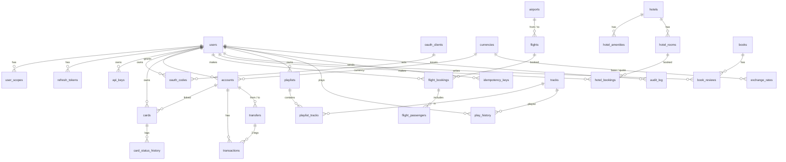

# API Lab — verilənlər bazası

SQLite (`data/apilab.db`), raw SQL, ORM yoxdur.

| Əmr | Nə edir |
|---|---|
| `npm run db:reset` | Bütün cədvəlləri silir → migration-lar → seed → `db/schema.sql` yenilənir, cədvəl sayları göstərilir |
| `npm run db:migrate` | Yalnız tətbiq olunmamış migration-ları işlədir |
| `npm run db:seed` | Datanı silib seed-i yenidən yükləyir (sxemə toxunmur) |
| `npm run db:shell` | `sqlite3` CLI (məs. `.tables`, `.schema cards`, `SELECT * FROM v_card_overview;`) |

## Qovluqlar

- `migrations/` — sxem dəyişiklikləri, ardıcıl nömrə ilə (`001_init.sql`, `002_views_triggers.sql`). Tətbiq olunanlar `schema_migrations` cədvəlində.
- `seed/` — demo data. **Deterministikdir**: eyni gündə hər `db:reset` eyni datanı verir. Tarixlər `date('now', ...)` ilə bu günə nisbətən hesablanır, ona görə reys/otel axtarışı həmişə gələcək tarixlərdə nəticə qaytarır.
- `queries/` — tələbələr üçün hazır yoxlama sorğuları (SQL Playground-da istifadə olunur).
- `schema.sql` — cari tam sxem (avtomatik yaradılır, əl ilə dəyişməyin).

## Konvensiyalar

- **Pul** `*_minor INTEGER` — qəpik/sent. `245075` = `2450.75 AZN`. API-də decimal göstərilir. Float istifadə etmirik, çünki `0.1 + 0.2 ≠ 0.3`.
- **Vaxt** ISO-8601 UTC mətn: `2026-10-12T08:30:00Z`. **Tarix**: `YYYY-MM-DD`.
- **Status sahələri** `CHECK (status IN (...))` ilə məhdudlaşdırılır.
- `PRAGMA foreign_keys = ON` hər bağlantıda yandırılır (SQLite-da default sönülüdür).
- `AUTOINCREMENT` — silinmiş id təkrar istifadə olunmur (məs. silinmiş müştərinin id-si yeni müştəriyə verilmir).

## ER diaqram

`customers`, `request_log`, `rate_limit_counters` müstəqil cədvəllərdir (FK yoxdur).

## Cədvəllər qısaca

| Sahə | Cədvəllər | Hansı API konsepsiyasını göstərir |
|---|---|---|
| Auth | users, user_scopes, refresh_tokens, api_keys, oauth_clients, oauth_codes | JWT scope-ları, refresh token rotation, API Key, OAuth2 Authorization Code (birdəfəlik, 60 san) |
| Bank | accounts, cards, card_status_history, transfers, transactions | BOLA (başqasının kartı → 403), Idempotency, atomik transaction (DEBIT+CREDIT) |
| Valyuta | currencies, exchange_rates | Sadə GET, query parametrləri, API Key |
| Aviabilet | airports, flights, flight_bookings, flight_passengers | Axtarış + pagination/sort, 201 + Location, 409 SOLD_OUT |
| Otel | hotels, hotel_amenities, hotel_rooms, hotel_bookings | Availability (tarix kəsişməsi → 409), PATCH |
| Müştərilər | customers | Tam CRUD (auth tələb etmir — Dərs 2 security-dən əvvəldir), ETag (`updated_at`-dan), 409 EMAIL_EXISTS |
| Kitab | books, book_reviews | Cursor pagination, nested resurs |
| Musiqi | tracks, playlists, playlist_tracks, play_history | Xarici API (YouTube) inteqrasiyası, kompozit PK |
| Texniki | idempotency_keys, audit_log, request_log, rate_limit_counters | Idempotency-Key, audit, API History, 429 |

## View-lar və trigger-lər

| Obyekt | Təsvir |
|---|---|
| `v_account_balances` | Hesab + sahib + decimal balans + əməliyyat sayı |
| `v_card_overview` | Kart + sahib + son status dəyişikliyi |
| `v_flight_search` | Reys + şəhər adları (airports-a 2 dəfə JOIN) |
| `v_hotel_availability` | Otaq bu gün dolu/boş, növbəti bron |
| `v_api_usage_by_endpoint` | `request_log` üzrə endpoint statistikası |
| `trg_cards_status_history` | `cards.status` dəyişəndə tarixçəyə yazır (`status_reason`, `status_changed_by`, `updated_at`-dan) |
| `trg_transactions_audit` | Hər yeni əməliyyatı `audit_log`-a yazır |

## Demo data (seed)

| Nə | Qeyd |
|---|---|
| İstifadəçilər | `student/student123` (Aysel Məmmədova), `rauf/rauf123` (`cards:write` scope-u yoxdur → 403 nümunəsi), `admin/admin123` |
| Hesablar | student: `AZ21NABZ0001` (AZN), `…0002` (USD), `…0003` (EUR); rauf: `…0004` (AZN), `…0005` (USD); admin: `…0006` |
| Kartlar | 1, 2 — student ACTIVE; 3 — student BLOCKED (LOST, açıla bilər); 4 — EXPIRED; 5, 6 — rauf (BOLA testi üçün); 7 — admin |
| API Key | `apilab-demo-key-2026` (aktiv), `apilab-revoked-key-2025` (deaktiv → 401) |
| OAuth client | `apilab-portal` / `apilab-portal-secret` |
| Reyslər | Sabahdan 30 gün: GYD↔IST/SAW/DXB/TBS/LHR/FRA/CDG/NAJ/GNJ; bəzilərində `seats_left = 0` |
| Otel | 16 otel / 57 otaq. Otaq 1 (Xəzər Sahil, SINGLE) +5…+8 gün dolu — 409 nümunəsi |
